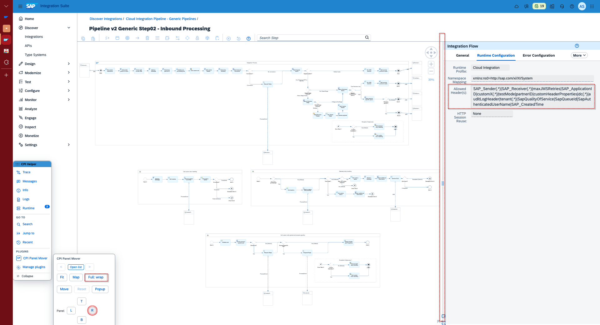
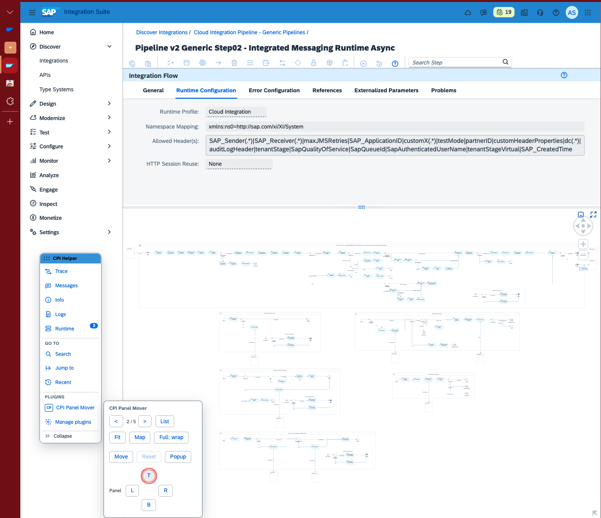
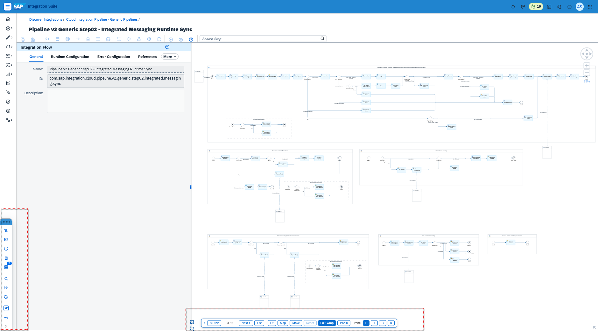
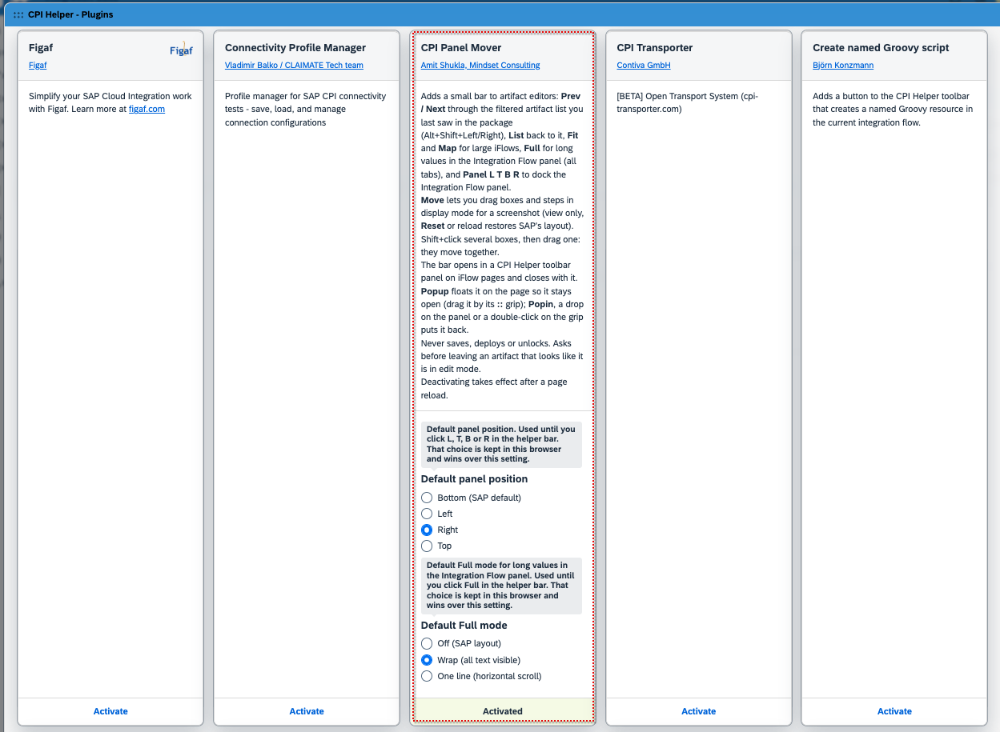

# CPI Panel Mover

A plugin for [CPI Helper](https://github.com/dbeck121/CPI-Helper-Chrome-Extension) (v4 and later) that makes large iFlows and long packages in SAP Cloud Integration easier to work with.

It adds a small bar to artifact pages in Design and Discover:

| Button | What it does |
|---|---|
| **< Prev / Next >** | Steps through the filtered, sorted artifact list you last saw in the package. Also Alt+Shift+Left / Right. |
| **List** | Back to that list. |
| **Fit** | Zooms the whole diagram into view. |
| **Map** | Shows or hides SAP's own minimap. |
| **Full** | Shows complete values in the Integration Flow panel, on every tab. Wrap, or one line with horizontal scroll. |
| **Panel L T B R** | Docks the Integration Flow panel left, top, bottom or right. The side width is remembered. |
| **Move / Reset** | Drag boxes and steps in display mode to frame a screenshot. Shift+click several boxes to move them together. Never saved. |
| **Popup / Popin** | Floats the bar on the page, or puts it back in its CPI Helper toolbar panel. |

The bar opens from the CPI Helper toolbar, under Plugins. Popup keeps it on the page while you work on the diagram.

## Safety

- No network requests. It reads and arranges the page through SAP UI5 and the DOM only.
- Never saves, deploys or unlocks. Moves are undone before SAP's Edit, so they cannot reach a save.
- Asks before leaving an artifact that looks like it is in edit mode.

## Screenshots

Integration Flow panel on the right, full values wrapped:

Panel on top, Prev / Next through the package list:

Panel on the left, bar popped out at the bottom of the page:

Plugin settings in CPI Helper:

## Install

The plugin is proposed for CPI Helper itself: [pull request](PR_LINK). Once merged, switch it on under **Manage plugins** in the CPI Helper toolbar.

Until then, in a local clone of CPI Helper:

1. Copy `plugins/cpiPanelMover.js` and `plugins/cpiPanelMover-inject.js` into its `plugins/` folder.
2. In `manifest.json`, add `"/plugins/cpiPanelMover.js",` to `content_scripts[0].js` after the last plugin, and `"plugins/cpiPanelMover-inject.js",` to `web_accessible_resources[0].resources`.
3. Load the folder as an unpacked extension and switch the plugin on under **Manage plugins**.

Settings: default panel position and default Full mode. A click on the bar wins over both and is kept in the browser.

## License

GPLv3, like CPI Helper. See [LICENSE](LICENSE).

Author: Amit Shukla, [Mindset Consulting](https://mindsetconsulting.com).
